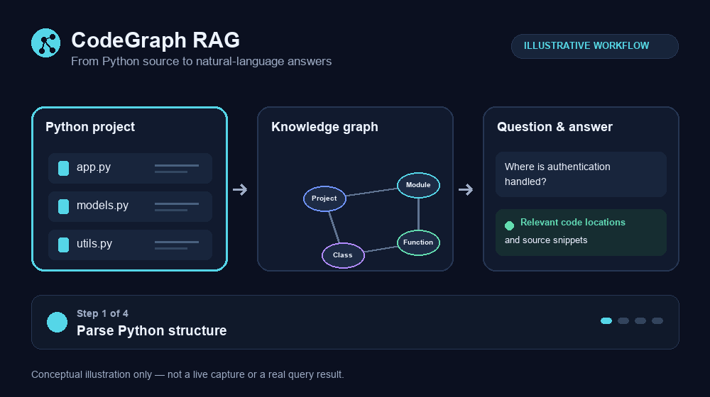

# CodeGraph RAG Memgraph

CodeGraph RAG analyzes Python repositories, stores their structure in a
[Memgraph](https://memgraph.com/) knowledge graph, and lets you ask questions
about the code in natural language using Google Gemini.



*Conceptual illustration; this is not a live capture or a real query result.*

## What it does

- Parses Python files with the standard-library AST parser.
- Represents repositories, folders, files, packages, modules, classes,
  functions, methods, and declared dependencies in Memgraph.
- Generates Cypher from natural-language questions with Gemini.
- Retrieves matching source code and reads relevant files from the target
  repository during a query session.
- Keeps conversation history in the interactive CLI session.

## Requirements

- Python 3.12 or newer
- [`uv`](https://docs.astral.sh/uv/)
- Docker with Docker Compose
- A Google Gemini API key

## Setup

Clone the repository and install its dependencies:

```bash
git clone https://github.com/i-mein/codegraph-rag-memgraph.git
cd codegraph-rag-memgraph
uv sync
```

Create a `.env` file in the project root with your Gemini key and optional
settings:

```dotenv
GEMINI_API_KEY=your-api-key
GEMINI_MODEL_ID=gemini-2.5-pro-preview-06-05
MEMGRAPH_HOST=localhost
MEMGRAPH_PORT=7687
TARGET_REPO_PATH=.
```

`GEMINI_API_KEY` is required by the query application. The other values shown
are defaults and can be omitted. Keep `.env` private; it is excluded from Git.

Start Memgraph and Memgraph Lab:

```bash
docker compose up -d
```

Memgraph listens on `localhost:7687`; Memgraph Lab is available at
<http://localhost:3100>.

## Ingest a repository

Pass either a local repository directory or a GitHub HTTPS URL to the parser:

```bash
# Local checkout
uv run python repo_parser.py /path/to/python-project

# Clone a GitHub repository into ./knowledge and ingest it
uv run python repo_parser.py https://github.com/owner/project.git
```

The parser reads `MEMGRAPH_HOST` and `MEMGRAPH_PORT` from the environment. You
can also set them on the command line:

```bash
uv run python repo_parser.py /path/to/python-project --host localhost --port 7687
```

Available parser options:

| Option | Description |
| --- | --- |
| `--host HOST` | Memgraph host (default: `localhost`, or `MEMGRAPH_HOST`) |
| `--port PORT` | Memgraph Bolt port (default: `7687`, or `MEMGRAPH_PORT`) |
| `--batch-size N` | Number of write operations buffered together (default: `1000`) |
| `--clean` | **Deletes all existing graph data** before ingesting |

Use `--clean` only when it is safe to erase the entire Memgraph database; it
does not limit deletion to the repository being ingested. GitHub URLs that
require authentication must be accessible through your local Git credential
configuration. You can also clone them yourself and pass the local path.

## Ask questions

Start the interactive query CLI and point it at the same repository checkout
used for ingestion:

```bash
uv run python -m src.main --repo-path /path/to/python-project
```

If `--repo-path` is omitted, the application uses `TARGET_REPO_PATH` from
`.env` (or the current directory). Example questions:

- “Which classes handle database connections?”
- “Find functions related to authentication.”
- “What methods does the `UserService` class define?”
- “Show me where repository parsing starts.”

Enter `exit` or `quit` to end the session. The graph contains repository
structure and dependency metadata; source snippets and file contents are
retrieved from the path supplied to the CLI, so that checkout must remain
available.

## Project layout

```text
.
├── repo_parser.py             # AST parsing and Memgraph ingestion
├── src/
│   ├── main.py                # Interactive RAG CLI
│   ├── config.py              # Environment-based configuration
│   ├── prompts.py             # Gemini system prompts
│   ├── schemas.py             # Data schemas
│   ├── services/
│   │   ├── graph_db.py        # Memgraph access
│   │   └── llm.py             # Gemini agents
│   └── tools/                 # Graph query, code retrieval, file reading
├── docker-compose.yaml        # Memgraph and Memgraph Lab services
├── pyproject.toml             # Python project and dependencies
└── uv.lock                    # Locked dependency versions
```

## Troubleshooting

- **Cannot connect to Memgraph:** check `docker compose ps`, then confirm
  `MEMGRAPH_HOST` and `MEMGRAPH_PORT` match the running service.
- **Missing Gemini key:** set `GEMINI_API_KEY` in `.env` before starting the
  query CLI.
- **Code snippets or files are not found:** provide the local checkout path
  using `--repo-path`; it should correspond to the repository represented in
  the graph.
- **Private repository clone fails:** verify that Git can access the
  repository using your configured credentials, or clone it locally first.
